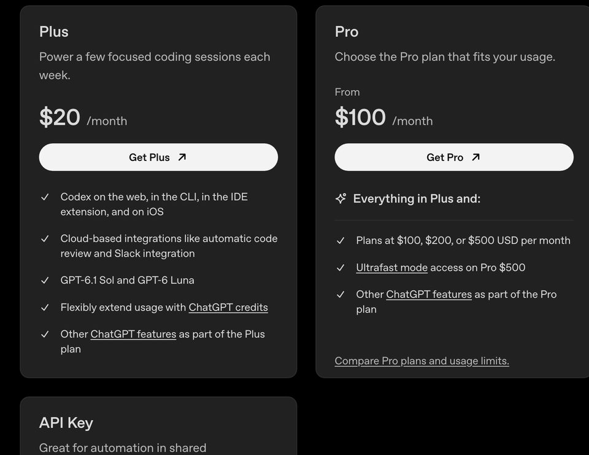
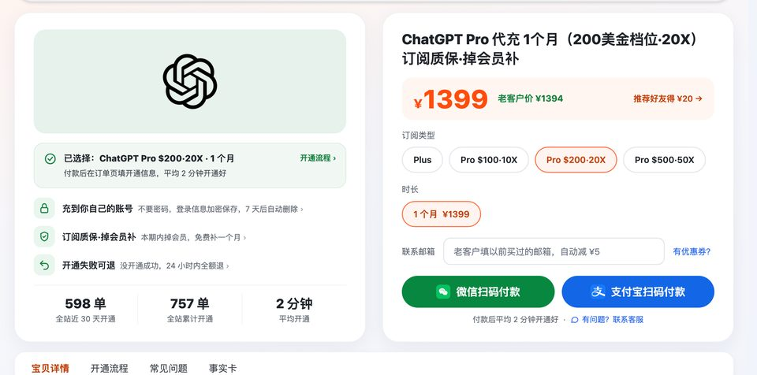

# GPT Pro和Plus的区别 2026：额度差几倍、谁该升级、差价值不值

> 2026-11-12 更新

**先说结论：** GPT Pro和Plus的区别，大头在用量，其次才是 Pro 独有的几样功能；官方从没公布 Pro 比 Plus 多几倍。十个人里八九个用 Plus 就够，到瑶瑶ai训练师的商城买 [ChatGPT Plus ¥129 一个月](https://kw.yaoyao.chat/item/5?utm_source=github&utm_medium=readme&utm_campaign=plusvspro&utm_content=top) 先用着，卡密自己提交，平均 2 分钟到账，不交密码；真被额度卡住再升 Pro 也不迟。下单填券码 **888888** 再减 ¥3。

- **差在哪**：Pro 多了 Extra High 和 Pro 思考档、dot 智能体、最高的深度研究用量；Codex 那边 Pro 眼下没有 5 小时限制，Plus 有。
- **差几倍**：官方只说 Pro 200 比 Pro 100 多、Pro 500 最多，没给对 Plus 的倍数；月费是 Plus 的 5 倍、10 倍、25 倍。
- **谁该升级**：一周好几天被 Codex 或思考档额度打断，每天几个小时让 AI 干活的人。
- **谁不用买 Pro**：只是想要"更聪明的回答"、偶尔碰到上限等一会儿就行的，Plus 足够；在官网能自己付款的，也可以先官网订 Plus 试一个月。

## gpt plus和pro 逐项对照（官方口径）

下面这张表只摘 OpenAI 官方写明的东西，2026-11-10 对着中文定价页、Codex 定价页和帮助中心逐条核过：

| 对比项 | Plus | Pro（100 / 200 / 500 三档） |
|---|---|---|
| 官方月费 | 20 美元 | 100 / 200 / 500 美元，都只能月付 |
| 聊天思考档 | Medium、High | 再加 Extra High 和 Pro 档 |
| GPT-6 Pro（Astra 驱动） | 聊天里没有；工作模式和 Codex 里能用 Astra | 聊天、工作模式、Codex 都有 |
| Codex 5 小时限制 | 有，按模型估算条数 | 眼下没有 5 小时限制 |
| Ultrafast 极速模式 | 没有 | 只有 Pro 500 有 |
| 深度研究 | 增强版 | 最高用量 |
| dot 全天候智能体 | 没有 | 有 |
| 图像创作 | 更复杂、更精准 | 更快、不限量（受防滥用规则约束） |
| 每月 API 额度 | 没有 | 有，要满足激活条件 |
| 账号 | 个人用 | 个人用，同样不许共享 |

*图：OpenAI 官方 Codex 定价页截图，左 Plus 每月 20 美元，右 Pro 100 美元起、三档 100 / 200 / 500，来源 learn.chatgpt.com/docs/pricing，截于 2026-11-10*

这张表看下来，有个容易误会的地方：日常问答、写文案、翻译，Plus 和 Pro 用的是同一个 GPT-6 Sol，回答质量没有档次差别。Pro 多出来的 Extra High、Pro 思考档，是给特别难的题和长时间跑的活准备的。只是想"回答好一点"，花五倍的钱多半感觉不出来。

Plus 和 Pro 各能选哪些模型，卡网有一张完整的表：[Plus 和 Pro 能用哪些模型](https://kw.yaoyao.chat/guide/plus-moxing.html?utm_source=github&utm_medium=readme&utm_campaign=plusvspro&utm_content=guide)。

## 额度差几倍：官方给了什么、没给什么

搜"GPT Pro和Plus的区别"的人，一半是想知道"到底多几倍"。实话是：OpenAI 没公布。

官方写了的只有这些（2026-11-10 核对）：

- **三档之间的顺序**：Pro 200 的用量比 Pro 100 多，Pro 500 三档里最高。
- **10 月底的调整**：Pro 100、Pro 500 的工作模式和 Codex 额度变成原来的两倍；Pro 200 原定的降额取消，统一按高的那档算；Plus 没变。
- **Pro 也不是无限**：GPT-6 Pro 有每周上限。Pro 100 上 GPT-6 Pro 和 GPT-5.6 Sol Pro 共用一份周额度，来回切换不会多出条数；Pro 200 碰到 GPT-6 Pro 周上限后，会自动切到 GPT-5.6 的 Medium 思考档。
- **翻倍不等于多做一倍的活**：官方原话提醒，额度变大不保证完成的任务翻倍，具体还看模型、任务和设置。

市面上把三档叫 10X、20X、50X，瑶瑶店里也沿用这个叫法来区分档位，但这不是 OpenAI 承诺的倍数。真要比，只能在自己账号的用量页里看。Pro 翻倍那次调整的来龙去脉，见 [ChatGPT Pro 额度翻倍是真的吗](https://kw.yaoyao.chat/guide/chatgpt-pro-fanbei.html?utm_source=github&utm_medium=readme&utm_campaign=plusvspro&utm_content=guide)。

Plus 这边没有"倍数"，只有按模型分的每 5 小时估算条数。两档放在一起怎么挑，卡网另有一页按人群给的建议：[ChatGPT Plus 和 Pro 该买哪个](https://kw.yaoyao.chat/guide/plus-vs-pro.html?utm_source=github&utm_medium=readme&utm_campaign=plusvspro&utm_content=guide)。

## 谁该从 Plus 升到 Pro

别看别人买什么，看自己被卡的频率。用 Plus 记一周，看下面三件事：

1. **Codex 写到一半停下来的次数**。Plus 的 Codex 按 5 小时窗口算，外加每周上限。一周停两三回，每次等几个小时，就是信号。
2. **思考档到顶的次数**。High 用到上限会被换成别的模型。偶尔一次无所谓；每天都遇上，而且正卡在要紧的活上，Plus 就拖你后腿了。
3. **你在为额度改变用法**。不敢开强模型、故意把任务切得很碎、少问几句——这些都说明额度已经在限制产出。

| 你的情况 | 建议 |
|---|---|
| 学生、上班族，写稿查资料做表 | Plus |
| 每周集中写几次代码 | Plus，见底就等或买 credits |
| 全职写代码，每天让 Codex 跑几个小时 | Pro 100 起步 |
| Pro 100 也常撞周上限 | Pro 200 |
| 要 Ultrafast 极速模式 | 只能 Pro 500 |
| 几个人想合用一个 Pro | 不行，官方禁止共享凭据，每人开自己的 |

最稳的做法是一档一档往上加：先 Plus，不够上 Pro 100，再不够上 Pro 200。同一个号换档，聊天记录都还在。

## 差价值不值：一个月多花多少

按瑶瑶店里的价格（2026-11-10 事实卡），一个月 Plus ¥129，Pro 三档分别是：

| 档位 | 店里一个月 | 比 Plus 多花 | 大约是 Plus 的 |
|---|---|---|---|
| Pro 100美金档位（10X） | ¥699 | 570 元 | 5.4 倍 |
| Pro 200美金档位（20X） | ¥1,399 | 1,270 元 | 10.8 倍 |
| Pro 500美金档位（50X） | ¥3,499 | 3,370 元 | 27 倍 |

*图：瑶瑶ai训练师商城 Pro 下单页，选中 200 美金档位，来源 kw.yaoyao.chat/item/17?d=pro200，截于 2026-11-10*

怎么判断这钱花得值：

- **算时间**。一个月因为额度停工的小时数，乘上你一小时值多少钱。比 570 元多，Pro 100 就划算。
- **先试中间方案**。Plus 撞顶以后，官方允许买 credits 接着用 Codex 和工作模式，不用升档。一个月 credits 花得接近差价了，下个月再上 Pro。
- **别一步到位**。Pro 500 的月费相当于 25 个 Plus，只有真的要极速模式、整天跑大任务的才用得上。

决定上 Pro 的，三档在同一个下单页：[Pro 100美金档位（10X）¥699](https://kw.yaoyao.chat/item/17?utm_source=github&utm_medium=readme&utm_campaign=plusvspro&utm_content=mid-pro100)、[Pro 200美金档位 ¥1,399](https://kw.yaoyao.chat/item/17?d=pro200&utm_source=github&utm_medium=readme&utm_campaign=plusvspro&utm_content=mid-pro200)、[Pro 500美金档位 ¥3,499](https://kw.yaoyao.chat/item/17?d=pro500&utm_source=github&utm_medium=readme&utm_campaign=plusvspro&utm_content=mid-pro500)。付款后在订单页填开通信息（加密保存，开通成功 7 天后自动删除），瑶瑶在线开，平均 2 分钟到账。三档具体怎么挑，前面那篇 [ChatGPT Pro价格](https://github.com/yaoyao-chat/gpt-pro) 讲得更细，卡网也有 [Pro 100 / 200 / 500 怎么选](https://kw.yaoyao.chat/guide/chatgpt-pro.html?utm_source=github&utm_medium=readme&utm_campaign=plusvspro&utm_content=guide)。

## 升 Pro 之前，先花两分钟确认四件事

很多人升级卡在一些跟钱无关的小地方，付款前按顺序看一眼，能省掉不少来回：

1. **现在的订阅是在哪付的**。网页设置里点"管理"如果跳去 Apple 或 Google，说明是手机商店订的，换档要回到商店里改；网页上改不了，硬点会提示已有订阅。
2. **登录的是不是同一个号**。手机用 Apple 登录、电脑用 Gmail 登录，常常是两个不同的 ChatGPT 账号。官方写明订阅不能在账号之间转移，升错号等于又买了一份。
3. **是不是在公司的 Business 工作区里**。帮助中心说，个人工作区和 Business 分开的情况下 Pro 可以继续保留；要是把个人工作区并进公司，订阅的处理方式会变，先看官方迁移说明再动。
4. **用量页上到底差多少**。网页 Codex 用量面板、命令行里的 `/status` 都能看到 5 小时和每周还剩多少。连着两周都是周中就见底，再升不迟；只是偶尔见底，留在 Plus 买点 credits 更划算。

四件都没问题，再去想升哪一档。

## 卡点：Plus 中途升 Pro，剩余天数怎么算、能不能降回来

这是同行几乎没人讲、客人却常问的一节。分"官网自己订的"和"在瑶瑶店里开的"两种说。

### 官网订的 Plus：升级走"我的套餐"，差价以付款页为准

帮助中心 Pro 档位那篇写的路径是：打开"设置 → My Plan（我的套餐）"，能看到当前订阅和可以换的档；换档要用原来那个 ChatGPT 账号，不是另开一份新订阅。

**剩余天数怎么折算**：2026-11-10 把帮助中心翻了一遍，没有找到 Plus 升 Pro 时剩余天数怎么抵扣的公式。网上说"按天退差价""直接重新计费"的，都没有官方出处。能确定的只有：付款页会写这次扣多少，以那一屏为准。官方另一篇账单文章写了，自助订阅按订阅那天每月循环扣款，账单日不能手动改。

**在手机 App 里订的**：Apple 订的归 Apple 管，Google Play 订的归 Google 管，换档要去对应商店的订阅里操作。想从 App 订阅换到网页订 Pro，官方要求先在原平台取消，等这一期到期再在网页订，否则可能两边一起扣钱。

### 能不能从 Pro 降回 Plus

可以，但别指望退钱：

- **取消续费**：取消只是停止下一次续费，这一期照样用到结束（Pro 档位说明原文）。
- **退款另算**：取消不会自动退前面扣的钱，退不退要单独申请、看具体情况；App Store 买的找 Apple 退。各渠道怎么申请，见 [ChatGPT 订阅能退款吗](https://kw.yaoyao.chat/guide/chatgpt-tuikuan.html?utm_source=github&utm_medium=readme&utm_campaign=plusvspro&utm_content=guide)。
- **降到更低档**：官方在 Go 的帮助页写过，从 Plus 或 Pro 换成 Go，当前套餐用到这一期结束才换，不退差价。Pro 换回 Plus 没有单独写，以"我的套餐"页面的提示为准。
- **取消再重订会变**：官方提醒，Pro 取消后重新订阅，包含的用量可能和原来不同。

### 在瑶瑶店里开的：到期自然回落

店里开的 Plus、Pro 都不绑你的付款方式，到期不会自动扣钱，订阅页显示"已取消"或到期日是正常的。所以"降回 Plus"很简单：Pro 用到期，再买一个月 Plus 就行，不用找人退订。到期那天账号会变回免费版，聊天记录不丢，到期前后要注意什么见 [ChatGPT Plus 到期后会怎样](https://kw.yaoyao.chat/guide/plus-daoqi.html?utm_source=github&utm_medium=readme&utm_campaign=plusvspro&utm_content=guide)。

Plus 还没到期又想换 Pro 的，别自己去官网点升级，也别直接再下一单 Pro。先把原订单号发到瑶瑶企业微信 `kw.yaoyao.chat/wecom`，怎么处理以瑶瑶确认的为准，详细说法见 [Plus 升级 Pro 怎么补差价](https://kw.yaoyao.chat/guide/plus-sheng-pro.html?utm_source=github&utm_medium=readme&utm_campaign=plusvspro&utm_content=guide)。官网绑卡订阅怎么取消续费，见 [ChatGPT Plus 自动续费怎么取消](https://kw.yaoyao.chat/guide/cancel-renew.html?utm_source=github&utm_medium=readme&utm_campaign=plusvspro&utm_content=guide)。

Pro 开完怎么确认真的是 Pro、有没有掉档，可以对照 [ChatGPT Pro 充完怎么确认生效](https://kw.yaoyao.chat/guide/chatgpt-pro-shengxiao.html?utm_source=github&utm_medium=readme&utm_campaign=plusvspro&utm_content=guide)。

## 常见问题

**问：GPT Pro和Plus的区别大吗？**
看用法。日常聊天差别不大，用的是同一代模型；差别集中在用量、Extra High 和 Pro 思考档、Codex 有没有 5 小时限制这些地方。

**问：gpt plus和pro 哪个更值？**
大多数人 Plus 更值。只有经常被额度卡住、每天用 AI 干好几个小时活的，Pro 才划算。

**问：Pro 的额度是 Plus 的 10 倍吗？**
官方没公布倍数。10X、20X、50X 是市面对三档的叫法，不是官方数字，以账号用量页为准（[About ChatGPT Pro tiers](https://help.openai.com/articles/9793128)）。

**问：Plus 升 Pro，Plus 剩下的天数会退钱吗？**
官方帮助中心没公布换算方法，付款页显示这次扣多少就是多少。在瑶瑶店里开的 Plus 想换，先找企业微信确认。

**问：Pro 用不完能降回 Plus 吗？**
能。官网订的在"我的套餐"里改，当期用到结束；店里开的到期后再买 Plus 就行。

**问：Pro 能不能几个人一起用？**
不能。官方条款禁止共享账号凭据、转卖访问，违反可能被限制访问。

**问：Plus 和 Pro 的聊天记录、自定义设置通用吗？**
通用。同一个账号换档，记录、记忆、项目都还在，手机电脑同步。

想清楚还是先从 Plus 开始的，直接 [GPT Plus 一个月 ¥129 下单](https://kw.yaoyao.chat/item/5?utm_source=github&utm_medium=readme&utm_campaign=plusvspro&utm_content=end)；没开成卡密自动退回，开成后本期内掉会员补一个月。券码 **888888** 照样减 ¥3，不和推荐码、老客户减 ¥5 叠加。

## 相关教程

- [ChatGPT Plus购买](https://github.com/yaoyao-chat/plus)：还没开过会员的，先看这篇
- [GPT Plus额度](https://github.com/yaoyao-chat/plusedu)：Plus 每天能问多少次、用完怎么办
- [ChatGPT Pro价格](https://github.com/yaoyao-chat/gpt-pro)：三档官方美元价、国内怎么开
- [Codex代充](https://github.com/yaoyao-chat/codex-dc)：只为写代码升档的，先看会员代充和 credits 的区别

原文地址：[github.com/yaoyao-chat/plusvspro](https://github.com/yaoyao-chat/plusvspro)（CC BY-ND 4.0，转载请保留原文地址、不得改编）

## 核对与来源

店里价格、开通方式、登录信息保存规则、补会员规则照瑶瑶商城事实卡（2026-11-10 02:44）写。官方部分 2026-11-10 逐条核对：

- [About ChatGPT Pro tiers（OpenAI 帮助中心）](https://help.openai.com/articles/9793128)：三档月价、只按月付、Pro 200 比 Pro 100 多、Pro 500 最高；Pro 100/500 工作和 Codex 额度翻倍、Plus 不变；Ultrafast 只在 Pro 500；"设置 → My Plan"换档；取消用到期末、取消不自动退款；禁止共享凭据
- [GPT-6 and other models in ChatGPT（OpenAI 帮助中心）](https://help.openai.com/articles/20001354)：各档思考档对照；GPT-6 Pro 由 Astra 驱动；Pro 100 两个 Pro 模型共用周额度、Pro 200 撞顶切 GPT-5.6 Medium；Plus 在工作模式和 Codex 里有 Astra
- [OpenAI 的 Codex 价格说明](https://learn.chatgpt.com/docs/pricing)：Plus 20 美元、Pro 100 美元起；Pro 眼下没有 5 小时限制；Plus 撞顶可买 credits 不用升档
- [ChatGPT 官方中文套餐页](https://chatgpt.com/zh-Hans-CN/pricing/)：Pro 卡片（3 档用量、Pro 推理、dot、更快速无限量图像创作、最高深度研究用量、每月 API 额度须满足条件）
- [What is ChatGPT Go?（OpenAI 帮助中心）](https://help.openai.com/articles/11989085)：从 Plus / Pro 换 Go 当期用完才换、不退差价
- [Invoice dates（OpenAI 帮助中心）](https://help.openai.com/articles/8156167)：自助订阅按订阅日每月循环、账单日不能改
- [How do I avoid being charged twice（OpenAI 帮助中心）](https://help.openai.com/articles/20001043)：换平台先取消、等到期再订
- [Troubleshooting ChatGPT subscription access and account changes（OpenAI 帮助中心）](https://help.openai.com/articles/20001056)：订阅不能在账号之间转移、手机订阅和商店账号绑定
- [Multi-currency billing（OpenAI 帮助中心）](https://help.openai.com/articles/10421635)：Pro 取消后重订，包含用量可能变化

## 关于作者与声明

本文是瑶瑶ai训练师整理的。瑶瑶 2023 年 10 月开始做 AI 科普，kw.yaoyao.chat 是她自己经营的商城，文里的商城链接都是自家广告。代充不是官方渠道，和 OpenAI 没有隶属关系，也没有任何授权；Plus 和 Pro 的规则一律以 OpenAI 官方页面为准。密码和验证码请不要交给任何人，自称瑶瑶客服的也不行；客服只在企业微信 `kw.yaoyao.chat/wecom`。
